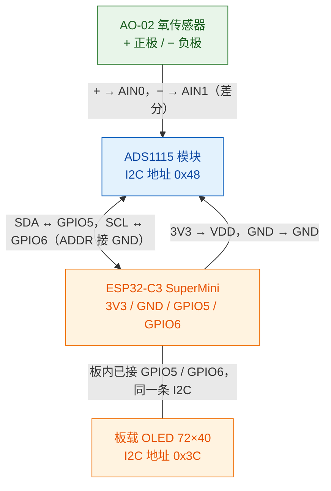
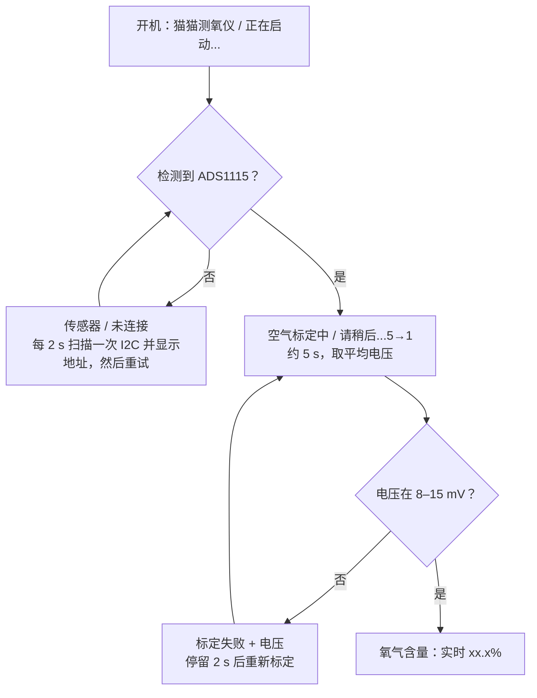

# 猫猫测氧仪（O₂Analyzer）

ESP32-C3（板载 0.42″ OLED）氧气分析仪：AO-02 氧传感器 + ADS1115 差分采样。  
氧浓度显示在 OLED，同时经 USB 串口输出；每次开机在空气中自动标定。仓库同时包含固件（`src/`）和 3D 打印外壳（`cad/`）。

## 硬件接线

板型为带 **0.42″ OLED（72×40，SSD1306）** 的 C3 SuperMini：屏已焊在板上，I2C 固定 **GPIO5（SDA）/ GPIO6（SCL）**。  
外接 `ADS1115`、`AO-02`。ADS1115 与板载 OLED **共用同一条 I2C**；AO-02 只进 ADS1115 模拟输入。



BOOT / RST 仅用于烧录，标定不使用按键。

### 1）C3 ↔ ADS1115（供电 + I2C）

| ADS1115 脚 | 接到 C3 | 作用 |
|------------|---------|------|
| **VDD** | **3V3** | 3.3 V 供电（不要接 5 V） |
| **GND** | **GND** | 共地 |
| **SDA** | **GPIO5** | I2C 数据线（与板载 OLED 共用） |
| **SCL** | **GPIO6** | I2C 时钟线（与板载 OLED 共用） |
| **ADDR** | **GND** | 地址固定为 `0x48` |

### 2）AO-02 ↔ ADS1115（模拟差分输入）

| AO-02 线 | 接到 ADS1115 | 说明 |
|----------|--------------|------|
| **+（正极）** | **AIN0** | 传感器输出正极 |
| **−（负极）** | **AIN1** | 传感器输出负极 |

固件读 AIN0−AIN1 的差分电压，增益 ×16（量程 ±256 mV），128 SPS。

### 注意

- AO-02 **不要**再并负载电阻，两根线直接进 AIN0 / AIN1。
- ADS1115 只用 **3.3 V**，与 C3 I2C 电平一致。
- 板载 OLED `0x3C` 与 ADS1115 `0x48` 同总线，互不冲突。
- **不要**用 GPIO0/1 做 I2C（本板 OLED 占用 5/6）。
- BOOT 仅用于进下载模式烧录，**空气标定为开机自动进行**。

## 环境

- [PlatformIO](https://platformio.org/)
- 板型：`esp32-c3-devkitm-1`（见 `platformio.ini`，环境名 `esp32-c3-supermini`）
- 串口：115200，USB CDC（`ARDUINO_USB_CDC_ON_BOOT`）
- 依赖：Adafruit ADS1X15、U8g2（PlatformIO 自动安装）

## 烧录

```bash
pio run -t upload --upload-port COMx
pio device monitor --port COMx
```

若上传失败：按住 **BOOT** → 点一下 **RESET** → 松开 BOOT 后再上传。

## 开机与界面



| 顺序 | 屏上内容 | 含义 |
|------|----------|------|
| 1 | **猫猫测氧仪** / 正在启动... | 开机 |
| 2 | **传感器** / 未连接 | 未检测到 ADS1115；随后短暂显示 I2C 扫描到的地址，每 2 s 重试 |
| 3 | **空气标定中** / 请稍后...5→1 | 开机自动空气标定（约 5 s） |
| 4 | **标定失败** / `x.xmV` | 空气电压不在窗口内，重新标定 |
| 5 | **氧气含量** / 大号 `xx.x%` | 实时氧浓度 |

换算：`O2% = V / V_air × 20.9`，其中 `V` 是最近 8 个采样（每 50 ms 一次）的平均值。

## 串口输出

| 行内容 | 含义 |
|--------|------|
| `O2Analyzer boot` | 上电 |
| `OLED_OK` / `OLED_FAIL` | 板载 OLED 自检 |
| `ADS_OK` / `ADS_FAIL` | ADS1115 自检；失败则每 2 s 重试 |
| `CAL_START` | 开始自动空气标定 |
| `CAL_COUNT n` | 倒计时秒数 |
| `CAL_SAMPLES n` | 这一秒读到的有效采样数（为 0 说明读不到 ADS） |
| `CAL_OK v_air_mV=...` | 标定成功并写入 NVS |
| `CAL_FAIL` / `CAL_FAIL v_mV=...` | 标定失败（无读数 / 电压不在 8–15 mV）后重试 |
| `O2=xx.xx% mV=x.xxx` | 实时氧浓度与毫伏，每 0.5 s 一行 |

## 标定说明

1. **在空气中开机**（传感器暴露于空气）。
2. 检测到 ADS 后自动进入 5 秒空气标定，无需按键。
3. 成功后空气中读数应接近 **20.9%**；`V_air` 写入 NVS（命名空间 `o2cal`）。
4. 每次上电都会重新标定。

空气合理电压窗口：**8–15 mV**（典型约 9–13 mV）。超出则 `CAL_FAIL` 并重试。

## 外壳与 3D 打印

`cad/` 里是 OpenSCAD 源文件，`cad/stl/` 是导出的打印文件。外壳为 v4：底部开口、自下向上装配，Type-C 口从底盖伸出。  
完整尺寸清单、调参提示见 [`cad/PRINT.txt`](cad/PRINT.txt)。

| 文件 | 内容 |
|------|------|
| `cad/o2analyzer_enclosure.scad` | 外壳全部零件和装配预览（`body_lower` / `body_upper` / `top_cap` / `bottom_cap`） |
| `cad/flow_restrictor_tee.scad` | 气流限流三通（M16×1 内螺纹，套在 AO-02 上） |
| `cad/ao_elec_gauge.scad` | AO-02 电极凸台形状检验板（薄片，先试配再打外壳） |
| `cad/export_*.scad` | 各零件的单独导出入口 |

**打印零件**：`stl/tee.stl`、`stl/body_lower.stl`、`stl/body_upper.stl`、`stl/top_cap.stl`、`stl/bottom_cap.stl`。  
`stl/body.stl` 是上下两半合在一起的装配预览，不用打印。

**装配顺序**

1. 从 `body_lower` 底部开口把「屏幕 + ESP32-C3」（排线已接好）向上推入：屏幕进 U 形导轨，PCB 进 ±Y 槽，直到 PCB 顶到限位。
2. ADS1115 从下方放进 −X 侧空腔（无托架），焊线向上走。
3. 压入 `bottom_cap`（Type-C 孔对准 +X 的屏幕侧，Type-C 头比外底多出约 1 mm）。
4. 把 `body_upper` 压在 `body_lower` 的接合套上。
5. AO-02 从顶部放入，直到电极座 / 肩部到位。
6. 压入 `top_cap`（摩擦盘卡在传感器肩部上方），M16 螺纹从 Ø20 孔伸出，可装回原盖或限流三通。

松紧不合适时按 `PRINT.txt` 里的 `join_male_extra`、`bot_interfere`、`top_interfere`、`m16_minor_d` 等参数微调后只重打对应零件。

## 工程结构

- `include/config.h` — 引脚与常量（各模块头文件也在 `include/`，实现在 `src/`）
- `src/ads_sensor.*` — ADS1115 差分读数（PGA ±256 mV）与 I2C 扫描
- `src/display.*` — 板载 SSD1306 72×40（`U8G2_SSD1306_72X40_ER` Soft-I2C + 中文）
- `src/calib.*` — NVS 存取 `V_air`
- `src/button.*` — BOOT 按键（保留，当前标定不用）
- `src/main.cpp` — 开机自动标定与主循环
- `cad/` — 外壳与三通的 OpenSCAD 源文件、`stl/` 打印文件

## 暂未实现

报警、无线、超级电容供电、纯氧两点标定。
